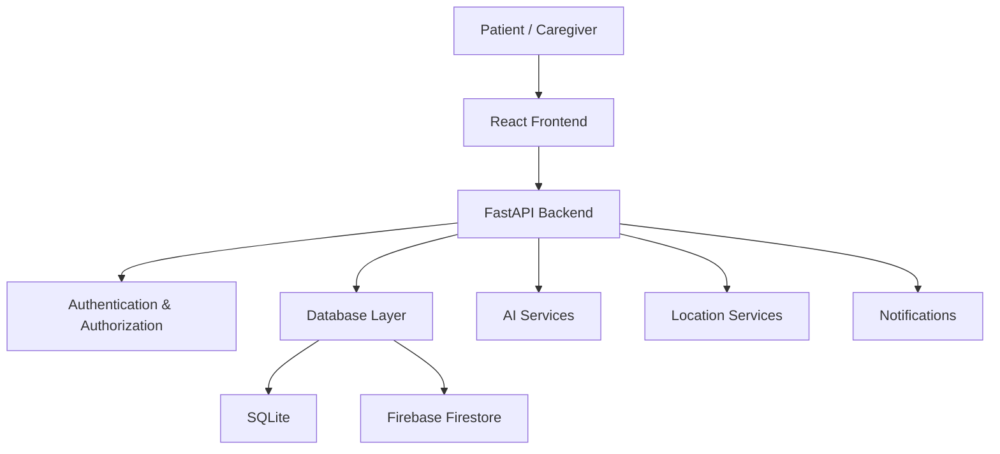

# 🧠 ReminAI

### Your Memories. Your Companion. Your Safety.

**ReminAI** is an AI-powered personal memory companion and patient-safety platform designed to support people living with dementia and help caregivers stay connected with their daily lives, memories and well-being.

Our goal is to combine personalized AI assistance, memory preservation and caregiver support in one accessible platform.

---

## 🌟 About the Project

Dementia can affect memory, communication, independence and everyday activities. ReminAI aims to make daily life easier by creating a personalized digital companion that helps patients reconnect with familiar memories while giving caregivers useful tools to support them.

The platform brings together memory assistance, daily routine management, family connections and patient-safety features.

## ✨ Key Features

> Feature availability is subject to the current development status of the project.

- 🧠 **Personal Memory Companion** – A personalized conversational experience designed around patient information and memories.
- 📸 **Memory Book** – Organize meaningful memories, photographs and personal experiences.
- 👨‍👩‍👧 **Family Connections** – Keep important family information accessible.
- 💊 **Daily Routine Support** – Manage daily activities and medication-related routines.
- 📍 **Location & Safety** – Location-based features intended to support patient safety.
- 🔔 **Caregiver Dashboard** – A centralized interface for caregiver-related information and monitoring.
- 🎙️ **Voice Interaction** – Explore more accessible voice-based interaction with AI.

Some features are still under development.

## 🛠️ Technology Stack

| Layer | Technology |
|---|---|
| Frontend | React, Vite |
| Styling | Tailwind CSS |
| Backend | Python, FastAPI |
| Authentication | JWT / Firebase integration |
| Database | SQLite / Firebase Firestore |
| AI Integration | Groq API |
| Maps | MapLibre GL / OpenFreeMap |

*The integrations listed above reflect the intended/current project stack; individual feature availability and configuration may vary.*

## 🏗️ System Architecture



## 📂 Project Structure

```text
ReminAI/
│
├── backend/
│   ├── app/
│   ├── .venv/
│   └── requirements.txt
│
├── frontend/
│   ├── src/
│   ├── public/
│   └── package.json
│
├── .gitignore
└── README.md
```

## ⚙️ Getting Started

### Prerequisites

- Python
- Node.js and npm
- Git
- Required Firebase and AI service configuration, where applicable

### 1. Clone the repository

```bash
git clone https://github.com/janhawi-x/ReminAI.git
cd ReminAI
```

### 2. Backend Setup

Open a terminal:

```powershell
cd backend

python -m venv .venv

.\.venv\Scripts\Activate.ps1

pip install -r requirements.txt
```

Configure the required environment variables using the backend environment example, if available.

Start the backend:

```powershell
python -m uvicorn app.main:app --host 127.0.0.1 --port 8001 --reload
```

Backend API documentation (when running):

`http://127.0.0.1:8001/docs`

### 3. Frontend Setup

Open another terminal:

```powershell
cd frontend

npm install

npm run dev
```

Open the local URL displayed by Vite in your terminal.

## 🔐 Security & Privacy

ReminAI is designed around the sensitive nature of personal and patient-related information.

Security considerations include:

- Authentication and authorization.
- Patient-specific data access.
- Protection of API credentials.
- Secure handling of personal information.
- Careful handling of location and memory data.

**Never commit `.env` files, Firebase service account credentials, private keys or real patient information to GitHub.**

## 🚧 Development Status

ReminAI is an actively developing project.

Current development focuses on:

- Authentication and role-based access.
- Patient and caregiver experiences.
- Persistent patient data.
- Personalized AI assistance.
- Memory and routine management.
- Patient-safety functionality.

## 🗺️ Roadmap

- [ ] Complete reliable patient data management.
- [ ] Improve personalized AI memory assistance.
- [ ] Strengthen patient and caregiver workflows.
- [ ] Improve location-based safety functionality.
- [ ] Enhance accessibility for elderly users.
- [ ] Conduct usability testing with appropriate consent.
- [ ] Evaluate security, privacy and reliability.

## 🤝 Contributing

Contributions, suggestions and feedback are welcome.

If you would like to contribute:

1. Fork the repository.
2. Create a feature branch.
3. Make your changes.
4. Test your implementation.
5. Submit a pull request.

## ⚠️ Disclaimer

ReminAI is an educational and developmental project. It is not a clinically validated medical device and does not replace professional medical care, diagnosis, emergency services or caregiver supervision.

## 💙 Our Mission

**Technology should not replace human memories or human connections. It should help preserve them.**

ReminAI aims to make technology more personal, accessible and supportive for people living with dementia and the families who care for them.

---

<p align="center">
  Made with 💙 for a more memory-friendly world.
</p>